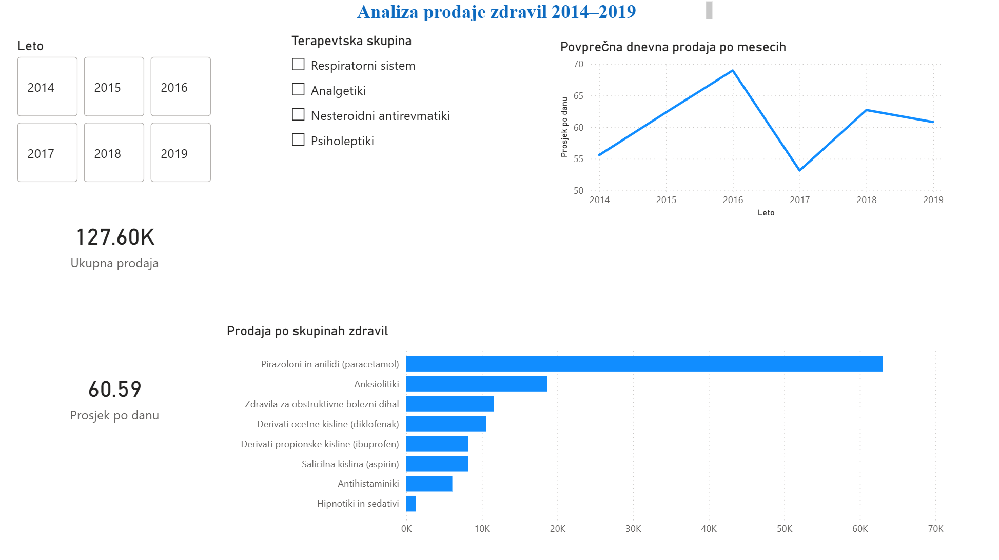
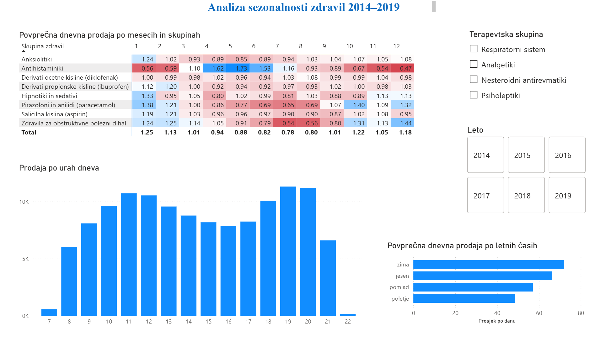

# pharmasales-analysis
Analiza prodaje zdravil 2014–2019

Ta projekt sem naredil, da bi v praksi preizkusil, kar sem se učil pri predmetih
Podatkovna skladišča in Menedžerski informacijski sistemi. Vzel sem javne podatke
o prodaji ene lekarne, jih uredil v PostgreSQL in naredil nadzorno ploščo v Power BI.

## Podatki

Pharma Sales Data s Kaggla: https://www.kaggle.com/datasets/milanzdravkovic/pharma-sales-data
Urna prodaja od januarja 2014 do oktobra 2019, razdeljena v 8 skupin zdravil po ATC klasifikaciji.

## Kaj sem naredil

Najprej sem CSV uvozil v staging tabelo, kjer so vsi stolpci besedilo. Nato sem
naredil zvezdno shemo: tabelo dejstev `fact_sales` ter dimenziji `dim_date` in `dim_atc`.

Podatki so bili v "širokem" formatu (vsaka skupina zdravil svoj stolpec), zato sem jih
z `UNION ALL` pretvoril v dolgi format. Ena vrstica je prodaja ene skupine v eni uri.
Tako je bilo kasneje v Power BI veliko lažje filtrirati in primerjati skupine.

SQL skripte so v mapi `sql`, po vrsti od 01 do 05.
V Power BI sem naredil dve strani: pregled prodaje in sezonskost.

## Kaj sem ugotovil

- Paracetamol predstavlja skoraj polovico vse prodaje.
- Antihistaminiki se največ prodajajo maja in junija, decembra pa skoraj trikrat manj, sezona alergij se v podatkih zelo jasno vidi.
- Zdravila za dihala imajo ravno obratno sezono, največ pozimi.
- Diklofenak in ibuprofen se prodajata enakomerno čez celo leto.
- V lekarni sta dva vrhunca prometa: okoli 11. ure in okoli 19. ure.

## Na kaj sem naletel

- Datumi so bili v ameriškem formatu (MM/DD/YYYY). Če bi jih prebral narobe, baza ne bi javila napake, samo dnevi in meseci bi se pomešali.
- Leto 2019 ni celo (podatki do 8. oktobra), zato sem za primerjave uporabil povprečno dnevno prodajo namesto skupne.
- V toplotni mapi je paracetamol s svojimi velikimi številkami "prekril" vse ostale skupine. Rešil sem z DAX meritvijo sezonski indeks, ki vsak mesec primerja s povprečjem iste skupine (`CALCULATE` + `ALL`).
- V letu 2017 je prodaja nekaj mesecev opazno nižja. Ne vem, ali gre za dejanski padec ali napako v podatkih.

## Orodja

PostgreSQL, pgAdmin, Power BI (DAX)

---
Ivan Đukić, magistrski študij Informatika v sodobni družbi, FIŠ Novo mesto
